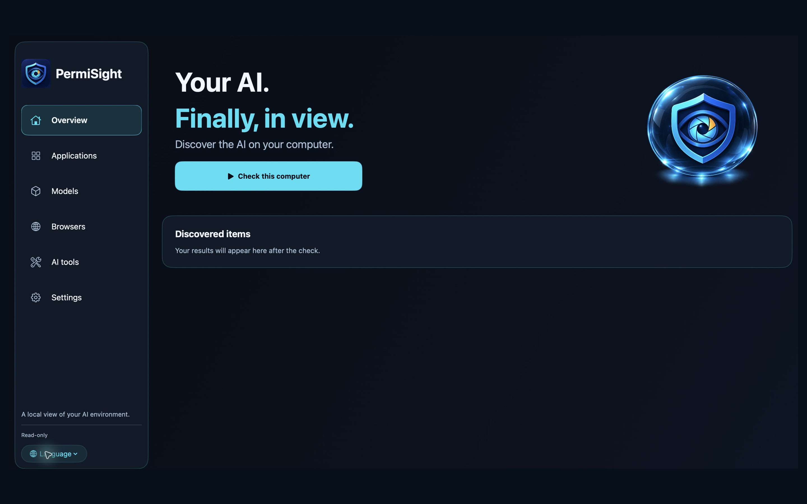
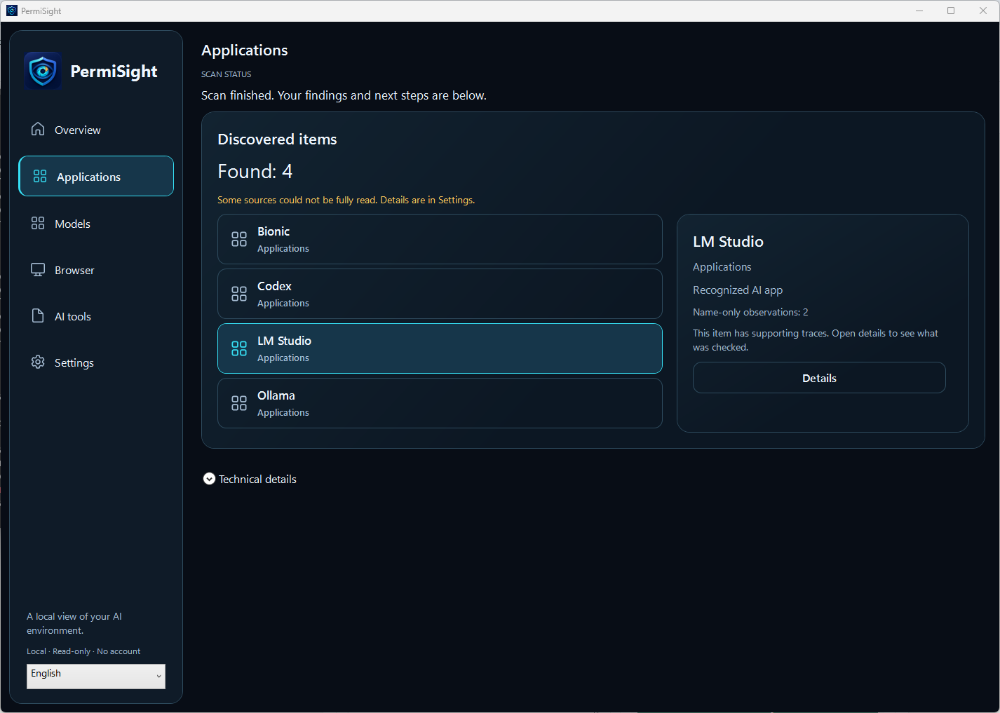

# PermiSight

**Vaše AI. Konečně přehledně.**

Zjistěte na jednom místě, jaké podporované AI aplikace, místní modely a doplňky
máte ve Windows nebo na Macu. Spusťte místní kontrolu, prohlédněte výsledky
a zjistěte, kterou část počítače se nepodařilo zkontrolovat.

[English](README.md) · [Web](https://www.permisight.com/) ·
[Stažení a stav platforem](DOWNLOADS.md) · [První kontrola](docs/QUICKSTART.cs.md)

[Nahlásit chybu nebo chybějící nástroj](https://github.com/petrvesely1969/PermiSight-Community/issues/new/choose) ·
[Dotazy a nápady](https://github.com/petrvesely1969/PermiSight-Community/discussions)

## Co s aplikací získáte

- Přehled podporovaných AI aplikací, souborů místních modelů, editorových
  a CLI nástrojů a rozšíření prohlížečů v podporovaných umístěních.
- Samostatné přehledy aplikací a modelů.
- Podklady k jednotlivým nálezům a srozumitelnou informaci o omezené kontrole.
- Uložení výsledků, ruční ověření aktualizace podepsaného katalogu a dobrovolné
  odeslání podporovaného reportu po náhledu a vašem souhlasu.

Osobní edice je zdarma a funguje bez registrace. Kontrola probíhá místně
a pouze čte. Dobrovolné odesílání reportů a ověřování aktualizací používá internet.

## Ukázka skutečné kontroly

Obrázky zachycují skutečnou aplikaci. Počty nálezů patří konkrétním testovacím
počítačům; nejsou velikostí katalogu ani příslibem stejného výsledku u vás.
[Ukázka modelu a původ snímků](assets/README.md).

## Pomozte nám zlepšovat detekci

Chybí vám nějaký nástroj? Napište jeho název, verzi, operační systém a očekávaný
výsledek. Konkrétní příklady nám pomohou rozšířit pokrytí.

- **Issues:** opakovatelné chyby, chybějící či nesprávné nálezy a konkrétní požadavky.
- **Discussions:** dotazy, nápady a zkušenosti. Můžete psát česky i anglicky.
- [Podpora a bezpečné sdílení](SUPPORT.md) · [Jak přispět](CONTRIBUTING.md)

Do veřejných příspěvků nevkládejte osobní údaje, celé reporty, soukromé cesty
ani přístupové údaje. Soukromou cestu pro hlášení popisuje stránka podpory.

## Jak rozumět nálezům

PermiSight popisuje technické stopy a dostupné důkazy. Nainstalovaná aplikace
nebo deklarovaná AI funkce sama neprokazuje, že je AI zapnutá, používaná nebo
odesílá data. Omezená kontrola zůstává viditelně označená. Aplikace nenajde
každý AI produkt a neurčuje, zda je program malware.
[Pokrytí a omezení](docs/COVERAGE.md).

Tento repozitář obsahuje veřejné informace o produktu a prostor pro komunitu.
Zdrojový kód aplikace se spravuje samostatně a zde zveřejněný není.
Firemní správa je plánovaný směr; vzdálená správa více počítačů není součástí
tohoto vydání.

[Soukromí](https://www.permisight.com/privacy/) ·
[Podpora](https://www.permisight.com/support/) · [Poznámky k verzím](CHANGELOG.md)

Vlastník produktu: Petr Veselý. Copyright © 2026 Petr Veselý.
