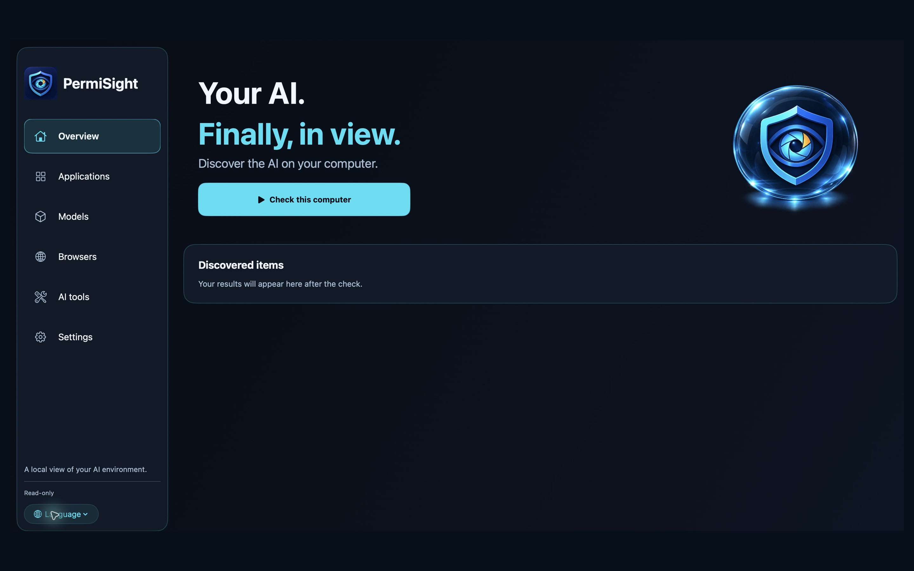
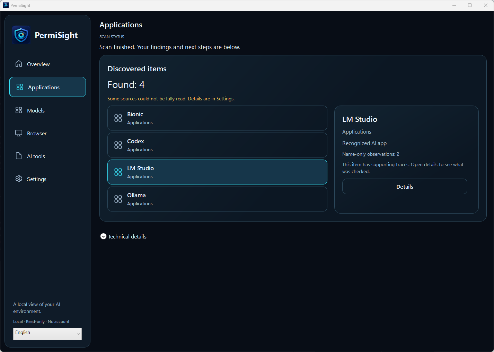

# PermiSight

**Your AI. Finally, in view.**

Find the supported AI apps, local models and add-ons on your Windows PC or Mac
in one place. Run a local check, explore the results and see which areas could
not be checked.

[Česky](README.cs.md) · [Website](https://www.permisight.com/) ·
[Downloads and platform status](DOWNLOADS.md) · [Quick start](docs/QUICKSTART.en.md)

[Report a bug or missing tool](https://github.com/petrvesely1969/PermiSight-Community/issues/new/choose) ·
[Questions and ideas](https://github.com/petrvesely1969/PermiSight-Community/discussions)

## What you can do

- Discover supported AI applications, local model files, editor/CLI tools and
  browser extensions in supported locations.
- Keep applications and models in separate, understandable views.
- Review the evidence behind a finding and any limits on the check.
- Save results, check for signed detection-catalog updates and voluntarily
  send a supported report after reviewing it and confirming consent.

The personal edition is free and works without an account. Scanning is local
and read-only. Optional report submission and update checks use the internet.

## See it in use

These are actual application screens. Results belong to individual test
computers; their counts do not describe the total catalog or guarantee the same
findings on another computer. [Model example and screenshot details](assets/README.md).

## Help improve detection

Found something missing? Tell us the tool name, version, operating system and
what you expected. A precise example helps us improve coverage.

- **Issues:** reproducible bugs, missing or incorrect detections, and concrete
  feature requests.
- **Discussions:** questions, ideas and experiences. English and Czech are welcome.
- [Support and safe sharing](SUPPORT.md) · [How to contribute](CONTRIBUTING.md)

Please keep public posts free of personal information, raw reports, private
paths and credentials. The support page explains the private reporting route.

## What a finding means

PermiSight describes technical traces and supported evidence. An installed
application or declared AI feature does not by itself prove that AI is enabled,
in use or transferring information. A restricted check remains visibly partial.
PermiSight does not find every AI product or classify malware.
[Coverage and limits](docs/COVERAGE.md).

This repository contains public product information and community materials.
The application's source code is maintained separately and is not published here.
Business administration features are planned; remote fleet management is not
part of this release.

[Privacy](https://www.permisight.com/privacy/) ·
[Support](https://www.permisight.com/support/) ·
[Version notes](CHANGELOG.md)

Product owner: Petr Veselý. Copyright © 2026 Petr Veselý.
