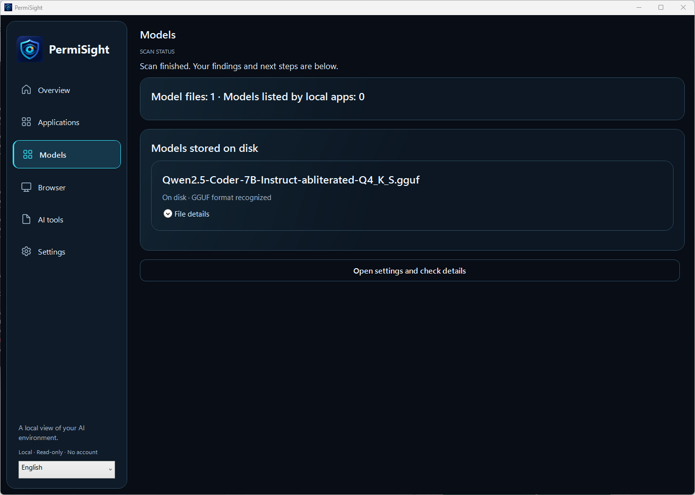

# Real application screenshots / Skutečné snímky aplikace

| File | Platform and capture | Content |
| --- | --- | --- |
| mac-overview-en.png | macOS, 30 October 2026, 1.0.1 build 19 | Overview before a check; English UI |
| windows-applications-en.png | Windows 11, 26 October 2026, 1.0.1 build 6507 | Four application findings on one test computer |
| windows-models-en.png | Windows 11, 26 October 2026, 1.0.1 build 6507 | One local GGUF model file on that computer |

The Mac image was prepared from an actual application window for the Store:
the title bar/frame was cropped and the content fitted proportionally on a
plain dark canvas. The Windows images are window captures. No finding or
coverage warning was rewritten or removed. No desktop, remote-control toolbar,
private file path, credential or report identifier is shown.

Mac build 20 changes the privacy manifest; these build 19 screens do not claim
a new build 20 capture. Counts are examples from specific machines, not catalog
totals or promises about another computer. File hashes and sizes are recorded
in [manifest.json](manifest.json).

## Česky

Jde o skutečné obrazovky, nikoli návrhy rozhraní. Na Macu byl oříznut rám okna
a zachován poměr stran. Windows snímky zachycují samotné okno. Výsledky ani
upozornění na omezenou kontrolu nebyly přepsány. Snímky neukazují soukromé
cesty, přístupové údaje ani identifikátory reportů.

Mac snímek pochází ze sestavení 19; sestavení 20 upravuje privacy manifest.
Počty položek patří konkrétním počítačům, nikoli celkovému katalogu.
